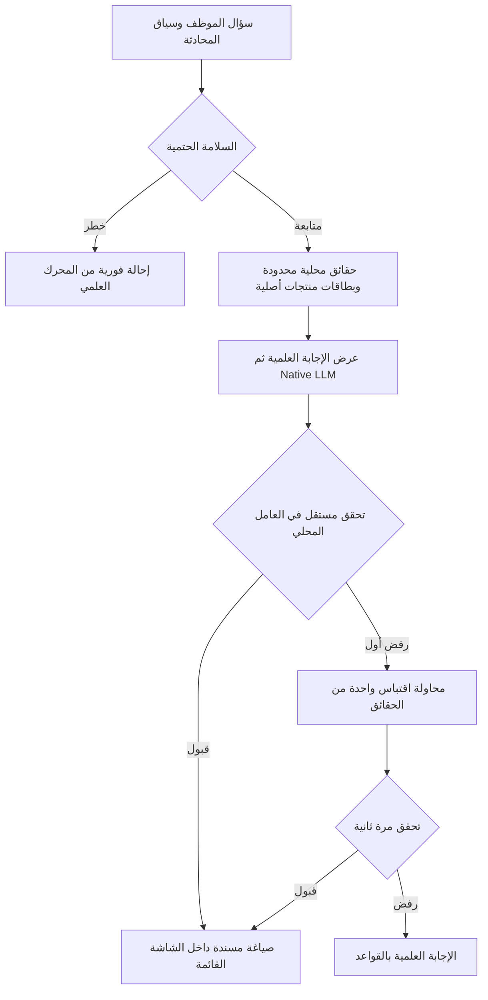

# MAKEUP HOUSE AI BEAUTY ADVISOR —3.1.0-rc.1

25 نوفمبر2026 — **تنفيذ فعلي ومرشح اختبار؛ ليس إصدارًا إنتاجيًا معتمدًا، ولم يكتمل نطاق V4.0 كله.**

## الملخص التنفيذي

IMPLEMENTED: استعادة المصدر، تجهيز toolchain، دمج استدلال محلي حقيقي C++/JNI داخل Capacitor القائم، إدارة نموذج معتمد، صياغة عربية مسندة إلى المعرفة المحلية، تحقق قبل العرض، محاولة اقتباس محدودة، وأثر تدقيق. بُني APK Debug وUnsigned Release فعليان بمكتبة ARM64، وحُفظت هوية التطبيق وبياناته ومنظومته العلمية.

VERIFIED/PASSED:191/191 اختبار server، TypeScript،9فحوص host-native حقيقية، واجهات ومسارات محلية و10000صنف وMHBAK1/MHBAK2 وتوافق بيانات التحديث. لا نتائج هاتف مزعومة.

BLOCKED: التوقيع الدائم الجديد يتطلب إجراء المالك المحلي؛ adb لا يرى هاتفًا أو emulator. NOT TESTED: الاستدلال والتنزيل ودورة الحياة والحرارة والبطارية والتحديث الموقع على Samsung. PARTIAL: NLU توليدي مستقل وذاكرة حوارية حرة واستدلال توليدي متقدم على بيانات المنتجات؛ هذه ما زالت تعتمد على المحرك السابق وليست مكتملة.

## الأساس مقابل التنفيذ الجديد

| المجال |3.0.0|3.1.0-rc.1|
|---|---|---|
| الاستدلال التوليدي الفعلي |لا runtime مفعّل |C++ llama.cpp + JNI + Java + TypeScript؛ host حقيقي وARM64 مبني |
| النموذج |لا مدير أوزان فعلي |Qwen3.5-2B/Q4_K_M منفصل، SHA وحجم وrevision ثابتة |
| العلم والمنتجات |المحرك الحتمي والمراجعة البشرية |محفوظان؛ لا تفويض سلطة علمية للنموذج |
| العربية |قواعد وفهم وسياق سابق |صياغة مولدة مقيدة؛ اقتباس عند فشل الصياغة؛ قواعد الفهم السابقة محفوظة |
| البيانات والنسخ |SQLite WASM، MHBAK1/2 |لا schema تخريبي؛ metadata إضافية؛ الأوزان خارج DB/backup |
| الأمن |Zod3.25.76 |Zod4.6.7؛ تعديل PATCH لمنع إفراغ حقول غير مرسلة |
| Android |com.makeuphouse.advisor،code4 |الهوية نفسها،code5،3.1.0-rc.1؛ release غير debuggable |

## المصدر والحوكمة

المستودع https://github.com/najeebhtamy3w-dev/makeup-house-ai-advisor ، الفرع work-local-ai-final-release، المرجع المستعاد5818514d0e9f6863c439896cba118bf95a880ffe. فُحص تاريخ الفروع؛ التطويرات المتباعدة تخص SMART STOCK أو وثائق مشاريع أخرى، فلم تدمج عشوائيًا. ZIP/bundle المرفقان أقدم من المرجع. main والفروع القديمة لم تتغير. الـcommit النهائي وشجرة Git وبصمات الملفات في DELIVERY_MANIFEST.json المرافق للتسليم؛ سجلات التنفيذ والـcheckpoints محفوظة على الفرع.

## القرار التقني

اعتمدت مكتبة llama.cpp v1.0.0 عند b1b770d، مع Qwen3.5-2B artifact من Unsloth وأصل رسمي Qwen. MIT للمحرك وApache-2.0 للنموذج بحسب مصادره؛ الإشعارات ضمن المصدر وAPK. فُحص LiteRT-LM وMLC وExecuTorch وORT وllama.kt وPrismLocal وPocket-AI وAiPaca وفهرس awesome-ai-apps. لم يُنسخ تطبيق بديل أو framework كامل. التفاصيل والمرشحون المستبعدون في OPEN_SOURCE_DISCOVERY_AND_SELECTION_REPORT.md.

الانتقال من Qwen3-1.7B وQwen2.5-1.5B إلى Qwen3.5 جاء بعد توليد وقياس حقيقيين، وليس اعتمادًا على عدد المعاملات. لا total score رقمي ملفق للإطار الموزون؛ معايير الهاتف لم تُقَس.

## المعمارية المنفذة

لا يمر نص raw إلى شاشة الموظف قبل التحقق. مصادر ومعرفات الحقائق من العامل، لا من اقتراح النموذج. تذاكر التحقق لمرة واحدة ومرتبطة بالمستخدم؛ لا يقبل العامل facts مرسلة من العميل. يولد native على executor واحد خارج UI thread. يظل اختيار المنتجات والملاءمة والتوفر والمراجعة العلمية من النظام السابق.

## القياس الحقيقي

| القياس | النتيجة | التصنيف |
|---|---|---|
| مجموعة اختيار النموذج |4/6 صياغة أولى،6/6 بعد اقتباس محدود |HOST VERIFIED؛ استكشافي |
| مجموعة مستقلة16حالة |7/14 أولى،12/14 بعد محاولة؛2fallback؛2خطر دون LLM |HOST VERIFIED؛ تحقق آلي |
| تحميل النموذج |2.99s |Linux، ليس Samsung |
| أول رمز بعد بدء التوليد |4.02s |Linux، ليس Samsung |
|55 رمزًا تشمل prefill |9.49s |Linux، ليس Samsung |
|max RSS |1.85GiB تقريبًا |Linux، ليس ذاكرة التطبيق على الهاتف |

نتيجة12/14 لا تعني جودة لغوية أو علمية بشرية12/14. الصياغة الأولى50% في المجموعة المستقلة حد واضح؛ التحسن بعد الاقتباس يزيد الأمان والإسناد لكنه لا يساوي استدلالًا حرًا متقدمًا.

## التحقق والانحدار

- PASSED: الأساس185/185 قبل التعديل؛ النهائي191/191،0failed و0skipped؛ TypeScript؛ npm audit0 vulnerabilities معلنة.
- PASSED: UI main/empty/nav/evidence/advisor/intel/back/images/final، وlocal-app10000/local-intel/local-final في Chromium131.
- PASSED: MHBAK2 وهجمات التلاعب، MHBAK1،100صنف وصور؛ بيانات المصدر القديم منAPKالموقّع تبقى بعد فتح الحزمة الجديدة علىOPFSنفسه.
- PASSED:9فحوص native host؛ بناء ARM64؛ ELF ومحاذاة16KB؛ ZIP integrity؛ عدم تضمين وزن/keystore؛ مطابقة31ملفًا للمصدر.
- NOT TESTED: جميع فحوص الجهاز الفعلية، تحديث APK موقع، stress2500 حديثًا، مراجعة علمية ولغوية بشرية مستقلة، fuzzing/native security شاملان.

فشل فحصا PATCH بعد ترقية Zod ثم أصلحا وعادت191 نتيجة خضراء. أصلح fixture legacy مكررًا في اختبار النسخ، وHTTP cache في اختبار ترقية البيانات، دون مسح OPFS. فشل تجهيز JDK/SDK/proxy في محاولات أولية ثم انتهى البناء النهائي بنجاح. السجلات الفاشلة الأولى محفوظة؛ لا تُعد PASSED.

## الملفات الرئيسية المعدلة

native/runtime.* وnative/CMakeLists.txt وmodel-manifest؛ android LocalAIPlugin.java/MainActivity.java/bridge.cpp/Gradle/assets؛ mobile/src/local-ai.ts/client.ts/worker.ts؛ server/src/local-ai.ts وcp08/routes.ts وroutes.ts؛ web/js/views-local-ai.js/views-intel.js/app.js؛ scripts/evaluate-local-ai*.ts وsign-release.sh؛ اختبارات local-ai وbackup/update؛ تقارير docs/v3.1. لا SQL migration تخريبي ولا إعادة كتابة للتطبيق.

## حالة الإصدار والتوقيع

APK فعلي:com.makeuphouse.advisor،3.1.0-rc.1/code5،min24/target36،ARM64،release debuggable=false،INTERNET+CAMERA. لا نموذج أو private key داخل APK. Unsigned يحتاج توقيعًا قبل التثبيت. Debug بتوقيع تطوير مختلف، وليس تحديثًا للتطبيق الدائم.

شهادة الإصدار القديم تحققت حديثًا وتطابق بصمة المالك b51bf9b0…4d6386. JKS المرفق لم يدخل المستودع أو الحزمة، ولم تُطلب كلمة مروره. script التوقيع المحلي يرفض شهادة غير مطابقة ويحافظ على16KB alignment ولا يكتب فوق ملف قائم.

## ما يحتاجه المالك

1. توقيع Unsigned APK محليًا بالمفتاح القائم وفق SIGNING_AND_CUSTODY_REPORT.md؛ لا إرسال لكلمة السر.
2. تثبيت التحديث فوق التطبيق الموقع القديم بعد نسخة احتياطية، دون uninstall.
3. تنفيذ SAMSUNG_ACCEPTANCE_V3_1.md وإرجاع التشخيص والأداء/الحرارة/نتائج العربية؛ مراجعة علمية مؤهلة قبل اعتماد الاستشارات إنتاجيًا.

## التوصية النهائية

**مرشح اختبار هندسي مشروط، لا إصدار إنتاجي نهائي.** الاستدلال المحلي الحقيقي مدمج ومبني، والمحافظة على الوظائف الأساسية مدعومة بانحدار جديد. التوقيع واختبار الهاتف والفهم التوليدي المتقدم والمراجعة العلمية/اللغوية الواسعة ما زالت غير محسومة. لا نعتبرV4.0منجزًا بالكامل أو التطبيقproduction-ready.
